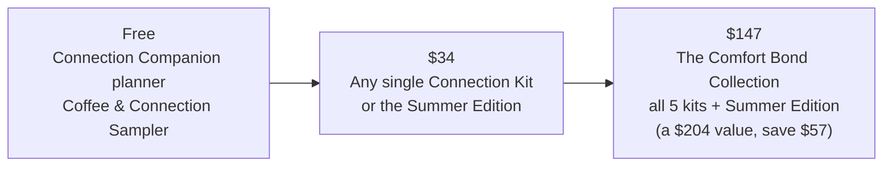
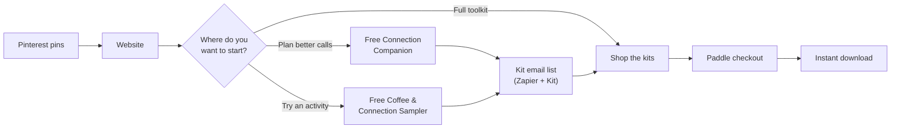

# The Comfort Bond™ — Building a Digital Product from Zero to One

> **Product case study · Portfolio project.** This case study walks through how I took a real product of my own from idea to launch: the problem, my product and marketing decisions, the results, and what I learned.

**I built The Comfort Bond™ from scratch as founder and product owner: the concept, the product line, pricing, the website, and the marketing.** It's a set of digital conversation and memory kits that help adult children and grandchildren have more meaningful moments, on calls and visits, with aging parents and grandparents.

**Live product:** [thecomfortbond.com](https://thecomfortbond.com/) · [Shop](https://thecomfortbond.com/shop)
**Timeline:** March – August 2026
**Status:** The website and products are live; no active marketing is running right now.
**Author:** Francesca Djoufack · [github.com/FrannyBrave](https://github.com/FrannyBrave)

---

## At a glance

| | |
|---|---|
| **My role** | Founder, product owner and product marketer. I owned every decision from the idea to launch |
| **Product** | 5 themed Connection Kits, a 13-week seasonal planner, a full bundle, and 2 free lead magnets, all digital downloads |
| **Pricing** | Free → $34 per kit → $147 for the full collection (a $204 value) |
| **Channels** | Pinterest (organic), email (Kit), website |
| **Results** | Paid sales through Paddle checkout · 21 email subscribers, mostly from the free sampler · 6.8K Pinterest impressions |
| **How I built it** | Lovable (website) · Claude Code & Claude Design (product design and building) · Claude Cowork (project management) · Canva (Pinterest pins) · Zapier + Kit (email automation) · Paddle (checkout) |

**Jump to:** [Why I built it](#why-i-built-it) · [The product](#the-product-side) · [The marketing](#the-marketing-side) · [Results](#results) · [What I learned](#what-i-learned)

---

## Why I built it

My grandmother was my last living grandparent. After she passed away, I started thinking more about how important it is to create meaningful moments with the older people in our lives while we still have them.

Connection doesn't have to mean elaborate plans or special occasions. Often it's a thoughtful conversation, a shared memory, or doing something together that feels familiar and brings joy. But many people don't know where to start. Calls drift into "How are you? Fine," and visits feel awkward or rushed.

**The problem I set out to solve:** adult children and grandchildren want deeper connection with aging loved ones, but they don't know what to talk about or what to do together, especially across distance and busy schedules.

## Refining the audience

I first designed The Comfort Bond for activity professionals in senior living communities: ready-to-use resources to help them plan meaningful activities for residents.

As the product took shape, I came back to what inspired it in the first place: families. Adult children and grandchildren often want to connect but struggle with what to say or do. So I shifted the primary audience to families. That meant rethinking the messaging, the packaging and the whole customer experience so the kits felt personal, easy to use, and part of everyday family life.

The mission stayed the same. I approached the same problem from a different angle, with a clearer focus on the people I originally wanted to help.

---

## The product side

### Designing the product line

I built the kits on **one repeatable format**, so every kit feels familiar and each new theme is fast to produce:

| Every kit includes | Why |
|---|---|
| 15–20 conversation prompts | Gives the next call a starting point beyond "How are you?" |
| 10 Visual Spark picture cards | Pictures help when words are harder, and work well for slow visits |
| 20 trivia questions | A light, low-pressure way to get talking |
| Picture & Word Memory BINGO | A shared game for in-person visits |
| Musical memory activities | Songs from the eras that shaped them |

Each kit is built around a **familiar life theme**, so families can pick the one that fits their loved one:

- **The Remember When Kit** (top seller): songs, headlines and daily rituals from past decades. The easiest place to start
- **The Kitchen Table Memories Kit** (top seller): recipes, holiday meals and Sunday rituals
- **The Garden Memories Kit:** porches, flowers and time outdoors
- **The Places We've Been Kit:** road trips and vacations; works well long distance
- **The Hands That Made It Kit:** for the maker, the mender and the fixer

I added **The Connection Season: Summer Edition**, a 41-page, 13-week planner, to turn one good visit into a **weekly habit**, with planning pages and "What They Told Me" pages to save stories, recipes and sayings.

### Key product decisions

| Decision | Why I made it |
|---|---|
| **Digital downloads, not physical products** | No inventory or shipping, instant delivery, and families can use them printed, on a tablet, or on a phone |
| **One format across all kits** | Consistent experience for customers and a fast, repeatable way to create new themes |
| **Themes based on everyday memories** | Kitchens, gardens and road trips are memories almost everyone has, so the kits feel personal without being custom |
| **Designed for calls *and* visits** | Many families live far apart; tags like "Long-Distance Friendly" help them choose |
| **Answering hard questions up front** | The FAQ covers worries like "Will my loved one feel patronized?" and "Is this for someone with memory loss?" |

### Pricing and packaging

- **Free** lowers the barrier: try a sample before spending anything.
- **$34** is one simple price for every kit, so choosing is about the theme, not the cost.
- **$147** rewards families who want everything, and the $204 comparison makes the savings clear.

---

## The marketing side

### Positioning

**For** adult children and grandchildren **who** want more meaningful calls and visits with the people who raised them, **The Comfort Bond** offers ready-to-use conversation and memory kits **that** make it easy to know what to say and do, **unlike** generic question lists or one-time gifts, because each kit is built around familiar life themes and designed for regular connection.

The brand rests on three pillars:
- **Connection:** simple prompts and rituals that make calls and visits feel meaningful
- **Relief:** a starting point when you don't know what to say, with less awkwardness and less guilt
- **Legacy:** capturing the recipes, sayings and stories that make them who they are

### The customer journey

The homepage gives visitors **three starting paths** based on what they want, instead of pushing everyone straight to the shop:
1. *"I want help planning more meaningful calls and visits."* → free weekly planner
2. *"I want to try a simple activity with my loved one."* → free sampler
3. *"I want the full toolkit for deeper bonding."* → the paid collection

### Channels

- **Pinterest:** I chose Pinterest because people go there to plan and look for ideas, which fits families searching for things to do with aging parents. I created the pins in Canva.
- **Email:** Free sign-ups flow into Kit through Zapier, building a list I can follow up with.
- **Website:** product pages organized by theme and tag, with a FAQ to answer buying questions.

---

## Results

| Metric | Result |
|---|---|
| Sales | Paid orders through Paddle checkout |
| Email subscribers | 21, mostly from the free Coffee & Connection Sampler |
| Pinterest impressions | 6.8K |
| Pinterest engagements | 42 |
| Pinterest outbound clicks | 6 |
| Pinterest total audience | 784 |

**What the numbers told me:** the free sampler was the strongest entry point; it drove most email sign-ups. Pinterest got the product seen (6.8K impressions), but only 6 people clicked through to the site, so the biggest drop-off was between seeing a pin and visiting the website.

## What I learned

- **Start with the person, then the product.** Coming back to my original inspiration made the audience, the messaging and the product clearer.
- **A free sample is a strong first step.** Most subscribers came through the free sampler, not the planner, so a hands-on taste of the product worked better than a planning tool.
- **Visibility isn't the same as traffic.** Pinterest impressions were strong, but clicks were low. Next, I'd test different pin designs, headlines and calls to action to get more people to the site.
- **Build a repeatable system.** One kit format made it fast to create five themes and a seasonal product.

## What I'd do next

- Test pin designs and headlines to raise Pinterest clicks
- Add an email welcome series that walks free subscribers from the sampler to their first kit
- Talk with buyers about which kit they chose and why, and use that to plan new themes
- Track the full funnel, from pin to site visit to sign-up to purchase, to see where to invest

---

*The Comfort Bond™ is my own product. The website code lives in a separate repository; this repo documents the product and marketing work only.*
