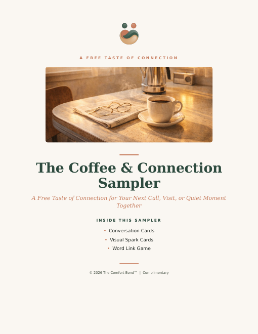
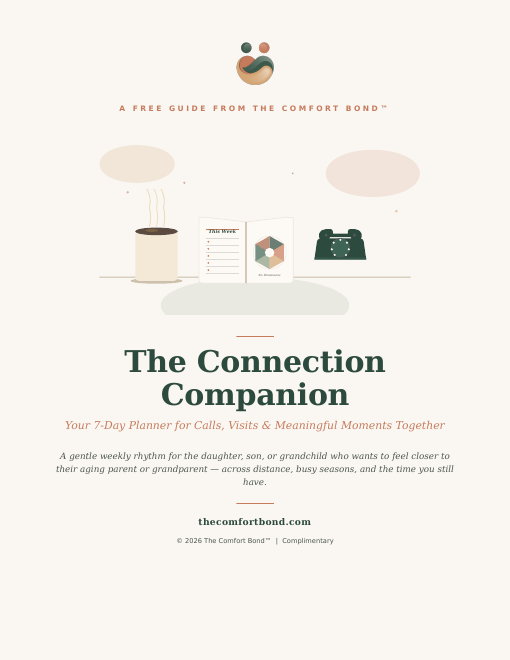
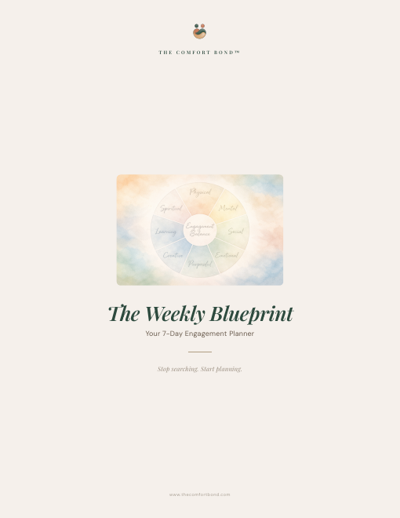
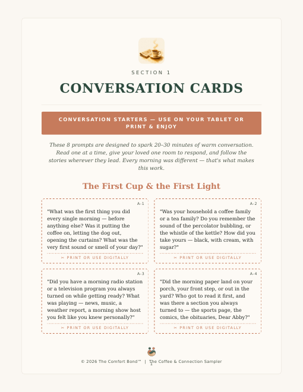
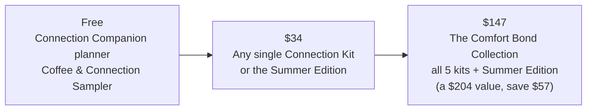
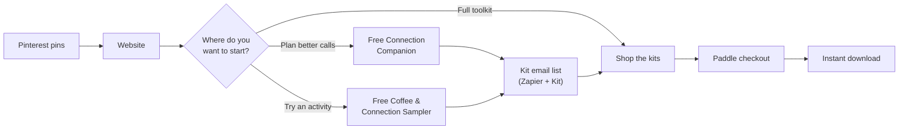

# 🤝 Product Spotlight: The Comfort Bond™

> **Product case study · Portfolio project.** This case study walks through how I took a real product of my own from idea to launch: the problem, the research, my product and marketing decisions, the results, and what I learned.

**I built The Comfort Bond™ from scratch as founder and product owner: the concept, the product line, pricing, the website, and the marketing.** It's a set of digital conversation and memory kits that help adult children and grandchildren have more meaningful moments, on calls and visits, with aging parents and grandparents.

**Live product:** [thecomfortbond.com](https://thecomfortbond.com/) · [Shop](https://thecomfortbond.com/shop) · [Free samples in this repo](#-the-product)
**Timeline:** March – August 2026 · **Status:** The website and products are live; no active marketing is running right now.
**Author:** Francesca Djoufack · [github.com/FrannyBrave](https://github.com/FrannyBrave)

| | |
|---|---|
| **My role** | Founder, product owner and product marketer. I owned every decision from the idea to launch |
| **Product** | 5 themed Connection Kits, a 13-week seasonal planner, a full bundle, and 2 free lead magnets, all digital downloads |
| **Pricing** | Free → $34 per kit → $147 for the full collection (a $204 value) |
| **Channels** | Pinterest (organic), email (Kit), website |
| **Results** | Paid sales through Paddle checkout · 21 email subscribers, mostly from the free sampler · 6.8K Pinterest impressions |
| **How I built it** | Lovable (website) · Claude Code & Claude Design (product design and building) · Claude Cowork (project management) · Canva (Pinterest pins) · Zapier + Kit (email automation) · Paddle (checkout) |

**Contents:** [The moment](#the-moment) · [Problem validation](#problem-validation) · [User research](#user-research) · [Refining the audience](#refining-the-audience) · [Personas](#personas) · [Prioritization](#opportunities-and-prioritization) · [MVP](#mvp-scope) · [The product](#-the-product) · [Go-to-market](#go-to-market) · [Results](#results) · [Lessons](#what-i-learned)

---

## The moment

*A scene many families will recognize:*

**Sunday, 4:00pm.** You finally have a free hour, so you call your mom. She lives three states away.

**4:02pm.** "How are you?" "Oh, fine. Same as always." You ask about the weather, her doctor's appointment, the neighbor's dog.

**4:09pm.** The conversation runs out. There's a pause. You both say you should talk more often.

**4:11pm.** You hang up feeling a little guilty. You love her, and you know you won't have these years forever. You just didn't know what else to say.

## Why I built it

My grandmother was my last living grandparent. After she passed away, I started thinking more about how important it is to create meaningful moments with the older people in our lives while we still have them.

Connection doesn't have to mean elaborate plans or special occasions. Often it's a thoughtful conversation, a shared memory, or doing something together that feels familiar and brings joy. I wanted to make those moments easier to create.

---

## Problem validation

Before building anything, I looked at whether this problem was bigger than my own experience. It is.

| Finding | Source |
|---|---|
| **1 in 3** U.S. adults aged 50–80 (33%) felt lonely some of the time or often in 2024, and 29% felt isolated | [University of Michigan National Poll on Healthy Aging, 2024 (published in *JAMA*)](https://ihpi.umich.edu/news/loneliness-and-isolation-back-pre-pandemic-levels-still-high-older-adults) |
| **Nearly 1 in 4** adults aged 65 and older are considered socially isolated | [National Academies of Sciences, Engineering, and Medicine, 2020, via NCOA](https://www.ncoa.org/article/navigating-social-isolation-and-loneliness-as-an-older-adult/) |
| **More than 10%** of family caregivers live an hour or more away from the person they care for | [AARP and National Alliance for Caregiving](https://www.aarp.org/caregiving/basics/long-distance-care/) |

### Initial insights

Loneliness in older adults is a huge problem space, from healthcare to housing. I narrowed it to one question I could act on:

> **How might we make it easier for families to have meaningful, regular connection with their aging loved ones, even across distance and busy schedules?**

My starting assumptions:
1. Families *want* to connect more, but don't know what to talk about or do together.
2. Familiar, nostalgic themes (kitchens, gardens, music, road trips) open conversations more easily than general questions.
3. Busy people need something ready to use in minutes, not another project.
4. A gentle routine matters more than one big visit.

---

## User research

I joined Facebook groups for **activity professionals** in senior living and for **family members caring for an aging loved one**, and talked with members about what made connection and engagement hard.

**What family caregivers told me:**
- They often **don't know what to talk about**, so calls and visits feel repetitive or end quickly.
- **Distance** makes staying connected hard.
- They **worry activities will feel childish** or patronizing to their loved one.
- **Memory loss** makes conversations harder.

**What activity professionals told me:**
- They spend a lot of time **searching for activity ideas**.
- They struggle to keep activities **varied and balanced** across residents' needs.
- They have **little time to plan** on top of everything else.

### Key takeaways

- Both groups had the same core problem: **not knowing what to say or do next.**
- Families' concerns were more personal (*"Will this feel childish?"*), so the product had to feel **dignified and adult**, never like a children's activity.
- Memory loss was a real factor, so prompts needed to work with **long-term memories** (old routines, songs, places) and **pictures**, not just recall questions.

---

## Refining the audience

I first designed The Comfort Bond for activity professionals: ready-to-use resources to help them plan meaningful activities for residents. My first free resource was **The Weekly Blueprint**, a 7-day engagement planner built around an "Engagement Balance Wheel" of six dimensions.

As the product took shape, I came back to what inspired it: my grandmother, and families. Adult children and grandchildren often want to connect but struggle with what to say or do. So I shifted the primary audience to families and rethought the messaging, packaging and customer experience to feel personal and part of everyday family life.

**What I kept, and what I changed:**

| Kept | Changed |
|---|---|
| The six-dimension framework (cognitive, emotional, sensory, social, creative, spiritual) | Renamed it the **"Six Dimensions of Bonding"** and rewrote it for one-on-one family moments |
| A simple weekly planning page | Redesigned the Weekly Blueprint as **The Connection Companion**, a 7-day planner for calls, visits and texts |
| Ready-to-use activities | Packaged them as **themed kits** families can choose by their loved one's interests |

The mission stayed the same. I approached the same problem from a different angle, with a clearer focus on the people I originally wanted to help.

---

## Personas

Built from my Facebook group conversations.

| Persona | Situation | What they need |
|---|---|---|
| **The long-distance daughter or son** | Works full time, lives hours away, calls on weekends | Prompts that make a 15-minute call feel meaningful, and a simple weekly rhythm |
| **The busy grandchild** | Loves their grandparent but struggles to keep conversations going | Easy, fun starting points that don't feel forced |
| **The family caregiver** | Visits often; their loved one has some memory changes | Activities built on long-term memories and pictures, that feel dignified, not childish |

## Problem space

**Pain points:** not knowing what to say · repetitive calls · distance · fear of being patronizing · memory changes · no time to plan

**Recurring themes:** *ease* (ready in minutes), *dignity* (adult and personal), *rhythm* (regular, not one-off)

---

## Opportunities and prioritization

I listed the ways I could solve the problem, then scored them with **RICE** (Reach × Impact × Confidence ÷ Effort). These are my own estimates looking back on my decisions: reach on a 1–10 scale, impact 1–3, effort in weeks.

| Opportunity | Reach | Impact | Confidence | Effort | RICE |
|---|---|---|---|---|---|
| Free sampler (lead magnet) | 10 | 2 | 80% | 1 | **16.0** |
| Themed conversation kits | 8 | 3 | 80% | 3 | **6.4** |
| Free weekly planner | 8 | 1 | 80% | 1 | **6.4** |
| Seasonal 13-week planner | 5 | 2 | 50% | 3 | **1.7** |
| Printed, shipped kits | 4 | 2 | 50% | 8 | **0.5** |
| Mobile app | 6 | 3 | 30% | 20 | **0.3** |

**What this told me:**
- **Free sampler first:** cheap to make and the best way to let people try the product before paying.
- **Themed kits as the core paid product:** highest impact, and one repeatable format made them fast to produce.
- **Seasonal planner later:** it builds a habit, but needed the kits to exist first.
- **No physical kits or app yet:** inventory, shipping and app development cost too much before proving demand.

## MVP scope

I launched with **digital downloads**, the fastest way to reach real customers:
- Two free entry points: the **Coffee & Connection Sampler** and **The Connection Companion**
- **Five themed Connection Kits**, each on one repeatable format
- A **bundle** for families who want everything
- Then the **Summer Edition** seasonal planner

Every kit uses the same format, so each new theme was fast to produce and familiar to customers:

| Every kit includes | Why |
|---|---|
| 15–20 conversation prompts | A starting point beyond "How are you?" |
| 10 Visual Spark picture cards | Pictures help when words are harder, especially with memory changes |
| 20 trivia questions | A light, low-pressure way to get talking |
| Picture & Word Memory BINGO | A shared game for in-person visits |
| Musical memory activities | Songs from the eras that shaped them |

The five themes, chosen around memories almost everyone has: **Remember When** (top seller), **Kitchen Table Memories** (top seller), **Garden Memories**, **Places We've Been** (long-distance friendly), and **The Hands That Made It**.

---

## 📦 The product

These free samples are the real product, so you can see the writing and design without signing up.

| [The Coffee & Connection Sampler](samples/The-Coffee-and-Connection-Sampler.pdf) | [The Connection Companion](samples/The-Connection-Companion.pdf) | [The Weekly Blueprint](samples/The-Weekly-Blueprint-for-Activity-Professionals.pdf) |
|---|---|---|
|  |  |  |
| **For families.** A mini kit: 8 conversation cards, 6 visual spark cards and a word game, built around morning rituals | **For families.** A free 7-day planner with the Six Dimensions of Bonding | **For activity professionals.** The original version, before I refined the audience |

**Inside the Coffee & Connection Sampler:**

---

## Go-to-market

### Pricing and packaging

- **Free** lowers the barrier: try it before spending anything.
- **$34** is one simple price for every kit, so choosing is about the theme, not the cost.
- **$147** rewards families who want everything, and the $204 comparison makes the savings clear.

### Positioning

**For** adult children and grandchildren **who** want more meaningful calls and visits with the people who raised them, **The Comfort Bond** offers ready-to-use conversation and memory kits **that** make it easy to know what to say and do, **unlike** generic question lists or one-time gifts, because each kit is built around familiar life themes and designed for regular connection.

The brand rests on three pillars: **Connection** (simple prompts and rituals), **Relief** (a starting point when you don't know what to say, with less awkwardness and less guilt) and **Legacy** (capturing the recipes, sayings and stories that make them who they are).

My research shaped the website directly. The FAQ answers the worries I heard, like *"Will my loved one feel patronized by this?"* and *"Are these for someone with memory loss?"*, and kits are tagged **"Long-Distance Friendly"** for families who live far away.

### The customer journey

### Channels

- **Pinterest:** people go there to plan and look for ideas, which fits families searching for things to do with aging parents. I designed the pins in Canva.
- **Email:** free sign-ups flow into Kit through Zapier, building a list I can follow up with.
- **Website:** built with Lovable and Claude Code, with product pages organized by theme and tag.

---

## Results

| Metric | Result |
|---|---|
| Sales | Paid orders through Paddle checkout |
| Email subscribers | 21, mostly from the free Coffee & Connection Sampler |
| Pinterest impressions | 6.8K |
| Pinterest engagements | 42 |
| Pinterest outbound clicks | 6 |
| Pinterest total audience | 784 |

**What the numbers told me:** the free sampler was the strongest entry point; it drove most email sign-ups. Pinterest got the product seen, but only 6 people clicked through to the site, so the biggest drop-off was between seeing a pin and visiting the website.

## How each persona uses it

- **The long-distance daughter or son** plans the week with The Connection Companion and uses a kit's prompts to turn a Sunday call into a real conversation.
- **The busy grandchild** starts with the free sampler or the Remember When Kit, an easy, fun way into family stories.
- **The family caregiver** uses the picture cards, BINGO and music activities on visits, built on long-term memories that still feel familiar.

## What I learned

- **Start with the person, then the product.** Coming back to my original inspiration made the audience, the messaging and the product clearer.
- **Listen for the worry behind the request.** Families didn't just want activities; they wanted ones that felt dignified. That shaped the design, the copy and the FAQ.
- **A free sample is a strong first step.** Most subscribers came through the free sampler, so a hands-on taste of the product worked better than a planning tool.
- **Visibility isn't the same as traffic.** Pinterest impressions were strong, but clicks were low.
- **Build a repeatable system.** One kit format made it fast to create five themes and a seasonal product.

## What I'd do next

- Test pin designs and headlines to raise Pinterest clicks
- Add an email welcome series that walks free subscribers from the sampler to their first kit
- Talk with buyers about which kit they chose and why, and use that to plan new themes
- Track the full funnel, from pin to site visit to sign-up to purchase, to see where to invest

---

*The Comfort Bond™ is my own product. The website code lives in a separate repository; this repo documents the product and marketing work and includes the free samples only.*
